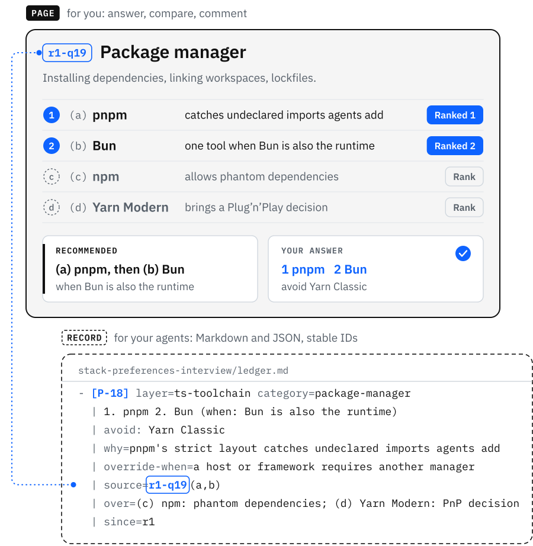
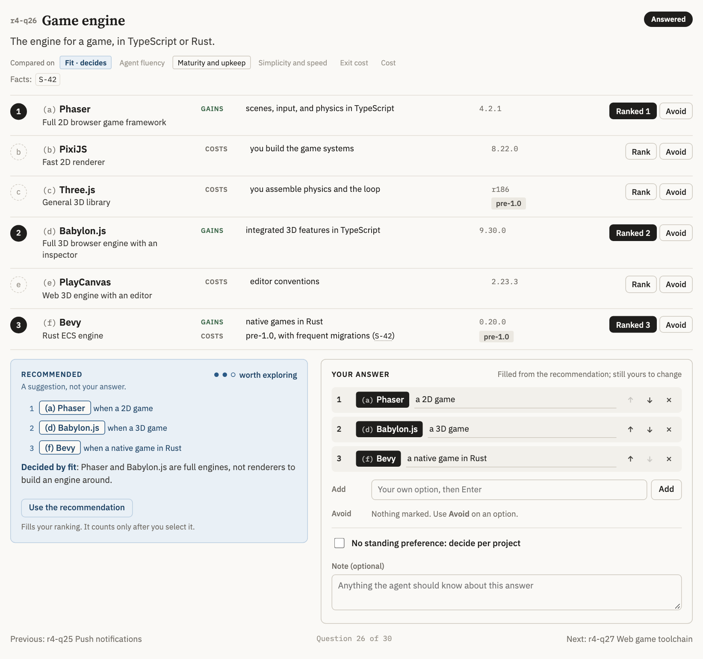

<p align="center">
  <picture>
    <source media="(prefers-color-scheme: dark)" srcset="docs/assets/wordmark-dark.svg">
    
  </picture>
</p>

<p align="center"><strong>The development lifecycle where you and your agents work from the same understanding.</strong></p>

<p align="center">You decide on interactive pages; your agents work from the records behind them.<br>Each skill states the outcome, the evidence, and who decides.<br>It leaves out steps a capable model already knows, so it improves as your models do.</p>

<p align="center">
  <a href="https://github.com/malhashemi/dubstack/actions/workflows/ci.yml"></a>
  <a href="LICENSE"></a>
  <a href="https://agent-plugins.org/"></a>
</p>

<p align="center">
  <a href="#install">Install</a> ·
  <a href="#start-here">Start here</a> ·
  <a href="#how-it-works">How it works</a> ·
  <a href="#what-makes-it-different">What makes it different</a> ·
  <a href="#the-skills">The skills</a> ·
  <a href="#for-agents">For agents</a> ·
  <a href="#learned-from">Learned from</a>
</p>

## One understanding, two readers

<p align="center">
  <picture>
    <source media="(prefers-color-scheme: dark)" srcset="docs/assets/two-readers-dark.svg">
    
  </picture>
</p>

Dubstack keeps each decision in two forms: a page you read and answer, and a record the agent reads. Both carry the same ID.

When a decision needs you, the agent builds a page with the options side by side, what each one makes true, and its recommendation with the reason for it. You answer there, comment on anything already settled, and hand the round back. The agent writes each decision into its record with the source, the rationale, and a stable ID. The next stage, a new session, or another agent reads that record and continues from it. When a question's meaning changes, it gets a new ID, so an earlier answer is never applied to it.

<p align="center">
  <picture>
    <source media="(prefers-color-scheme: dark)" srcset="docs/assets/interview-dark.png">
    
  </picture>
</p>
<p align="center"><sub>A real round from the interview that settled Dubstack's own stack preferences: 109 categories, decided over four rounds.</sub></p>

## Install

Dubstack is one plugin with 19 skills. Install it one way per agent, because the plugin and the standalone skills together give you every skill twice.

<details>
<summary><strong>Claude Code</strong></summary>

```sh
claude plugin marketplace add malhashemi/dubstack
claude plugin install dubstack@dubstack
```

Skills appear with the plugin's prefix, such as `/dubstack:basecamp`. Run `claude plugin update dubstack@dubstack` to update.

</details>

<details>
<summary><strong>Codex</strong></summary>

```sh
codex plugin marketplace add malhashemi/dubstack
codex plugin add dubstack@dubstack
```

</details>

<details>
<summary><strong>GitHub Copilot</strong> (CLI and VS Code)</summary>

```sh
copilot plugin install malhashemi/dubstack
```

In VS Code, run **Chat: Install Plugin From Source** and enter `https://github.com/malhashemi/dubstack`.

</details>

<details>
<summary><strong>Cursor, OpenCode, Gemini CLI, and other agents</strong></summary>

```sh
npx skills add malhashemi/dubstack
```

The [skills CLI](https://github.com/vercel-labs/skills) asks which agents to install for. Add `--skill <name>` to install one skill, and run `npx skills update` to update.

</details>

### What you need

- [Dossier](https://github.com/agent964dev/dossier), where most skills publish their pages and records. You need a workspace you can publish in. Either someone with a deployment invites you to one, or you host your own by following [Dossier's runbook](https://github.com/agent964dev/dossier/blob/main/docs/RUNBOOK.md#2-set-up-a-new-deployment-self-hosting). The maintainer's deployment, `dossier.agent964.com`, is invite-only. The CLI needs Node.js 22.12 or newer, and the `dubstack` guide walks you through the setup.
- The GitHub CLI, signed in, for issues and pull requests.
- Python 3 for the bundled scripts, and [uv](https://docs.astral.sh/uv/) for the brand toolkit.

Some skills work without Dossier: `orchestration-setup`, `stack-preferences`, `upstream-source`, `babysit-pr`, `brand-skill-generator`, `visualize-html`, `svg-design`, and `skill-writing`.

## Start here

1. **Tell your agents who does what.** If you work with more than one model, run `orchestration-setup` once. It reads your current global instructions and your setup, then writes which model owns implementation, review, research, and the rest, and how a session reaches each one.
2. **Ask the guide.** Run `dubstack` in any project and ask where it stands. It reads the repository, the project's pages, and its open pull requests, then names the next skill and why, starting with work already in progress.
3. **Bring work to `basecamp`.** Whether it's a one-line fix or a loose set of ideas, basecamp records the goal and chooses its route.

## How it works

<p align="center">
  <picture>
    <source media="(prefers-color-scheme: dark)" srcset="docs/assets/lifecycle-dark.svg">
    
  </picture>
</p>

Before the first project, `orchestration-setup` decides which model owns which work, and `stack-preferences` holds your preferred technologies, so every architecture starts from your choices rather than generic defaults.

Project context can come in any order. `project-home` builds the project's home, `design-interview` or a live `conversational-interview` gathers a customer's requirements, and `brand-skill-generator` develops a brand. `design-interview` also settles the project's vocabulary or runs a brainstorm.

A new project then gets its architecture through `design-interview`, the open-source references it needs through `upstream-source`, and a goal from `project-scaffolding` that sets up the whole stack, connected end to end, before the first feature. An existing codebase gets a goal that brings its checks and CI up to standard, with each check shown to fail on a deliberate violation. Then `architecture-review` finds where its structure makes change hard.

### The goal loop

Every piece of work starts at `basecamp`. It chooses the route by what remains unresolved, not by the size of the work:

| The goal still lacks | Next stage |
|---|---|
| Nothing: the intent is clear and the work fits one session | Do it now, then the pull request |
| Facts too large to find along the way | `research` |
| Decisions only you can make | `design-interview`: a design discussion, or a PRD then a TDD |
| Only a plan for work in several phases | `structure-outline` |
| An approved outline | `implement-outline`, one continuous run |
| A committed change | `describe-pr`, then `babysit-pr` until reviewers clear it |

Every stage hands back to basecamp, which records it on the goal's page and writes the handoff that starts the next. Between features, architecture review, dependency updates, and incoming issues all become goals the same way. The [guide's map](skills/dubstack/references/flow.md) covers the whole flow.

### A goal, start to finish

1. You tell `basecamp` that teams need to invite people by link. It records the goal, opens an issue, and finds decisions only you can make.
2. `design-interview` publishes a round: link expiry, who may invite, what an invitee sees on an expired link, each drawn with what it makes true and a recommendation. You answer in a few minutes and comment on one settled point.
3. The next round folds your answers in. When nothing is left open, the ledger freezes, and `structure-outline` turns it into phases with exact contracts and the checks that prove each one.
4. `implement-outline` builds the outline in one run, writing acceptance tests from the contracts first and recording demos as it verifies.
5. `describe-pr` opens the pull request with those demos attached and a walkthrough of the change, and `babysit-pr` carries it through CI and review. Basecamp marks the goal done when it merges.

## What makes it different

**Decisions go to you; facts go to the agent.** Every interview looks up what can be looked up and asks only what you alone can settle: intent, trade-offs, and first-hand knowledge. Each question comes with its options, their consequences, and a recommendation you can take or overrule.

**Goals keep their record across sessions.** Each goal has a record, a page, and its stages, and they carry over between sessions, people, and agents. Stable IDs connect an answer to the question it settled, the outline entry it shaped, and the check that proves it.

**Every stage proves its work.** A safeguard counts only once it has failed on a deliberate violation and passed again. `implement-outline` records demos while it verifies the work, and `describe-pr` attaches them to the pull request. `babysit-pr` treats a pull request as ready only when its reviewers have cleared its current revision.

**The skills improve as models do.** They describe outcomes, evidence, and who decides. They leave out procedures a capable model already knows, so nothing in them goes stale when a better model arrives. `skill-writing`, the skill they were all written with, is included.

**The project keeps its decisions.** The glossary, the architecture review's register of candidates and decisions, and your stack preferences each have one skill that writes them, so later work starts from what was decided instead of working it out again.

## The skills

**Start**

| Skill | What it does |
|---|---|
| [`dubstack`](skills/dubstack/SKILL.md) | Reads where a project stands and names the next skill, with the reason |
| [`orchestration-setup`](skills/orchestration-setup/SKILL.md) | Decides which model owns each kind of work and how sessions reach it |
| [`stack-preferences`](skills/stack-preferences/SKILL.md) | Keeps your preferred technologies per category, as data you can query and refresh |

**Project knowledge**

| Skill | What it does |
|---|---|
| [`project-home`](skills/project-home/SKILL.md) | Creates and maintains the project's home, goal list, and glossary page |
| [`design-interview`](skills/design-interview/SKILL.md) | Settles a PRD, TDD, design discussion, architecture, glossary, requirements, or brainstorm in rounds |
| [`conversational-interview`](skills/conversational-interview/SKILL.md) | Gathers requirements or brainstorms by voice or chat, and can move to and from pages |
| [`brand-skill-generator`](skills/brand-skill-generator/SKILL.md) | Develops a brand with you and packages it as a skill your agents apply |
| [`architecture-review`](skills/architecture-review/SKILL.md) | Finds where the structure makes change hard, proposes deeper modules, and keeps a record of past decisions |

**Foundations**

| Skill | What it does |
|---|---|
| [`upstream-source`](skills/upstream-source/SKILL.md) | Chooses and pins open-source repositories as local references for your agents |
| [`project-scaffolding`](skills/project-scaffolding/SKILL.md) | Opens a goal for a project's whole stack, or for an existing codebase's safeguards |

**The goal loop**

| Skill | What it does |
|---|---|
| [`basecamp`](skills/basecamp/SKILL.md) | Takes in a goal, chooses its next stage, and keeps its record and page current |
| [`research`](skills/research/SKILL.md) | Finds out how things are, with every finding sourced and dated |
| [`structure-outline`](skills/structure-outline/SKILL.md) | Turns an approved design into phases of outcomes, contracts, and checks |
| [`implement-outline`](skills/implement-outline/SKILL.md) | Builds an approved outline in one verified, reviewed run |
| [`describe-pr`](skills/describe-pr/SKILL.md) | Opens the pull request with demos attached and a walkthrough for larger changes |
| [`babysit-pr`](skills/babysit-pr/SKILL.md) | Carries a pull request through CI and review until it is cleared to merge |

**Craft**

| Skill | What it does |
|---|---|
| [`visualize-html`](skills/visualize-html/SKILL.md) | Builds visual explanations, comparisons, and feedback pages, locally or on Dossier |
| [`svg-design`](skills/svg-design/SKILL.md) | Designs logos, icons, and vector graphics as maintainable SVG code |
| [`skill-writing`](skills/skill-writing/SKILL.md) | Writes and reviews agent skills that guide without over-prescribing |

## For agents

If a user asked you to look at this repository, this section is for you.

- **Setting it up.** Install the plugin through the route for the user's agent under [Install](#install), or with `npx skills add malhashemi/dubstack`. Most skills publish to Dossier, so check `dossier whoami` and `dossier ls` before starting one of them. If either fails, walk the user through [Dossier's setup](skills/dubstack/references/dossier-setup.md).
- **Where to start.** `dubstack` reads where a project stands and names the next skill. If the user works with several models, `orchestration-setup` comes first. New work goes to `basecamp`.
- **Explaining it.** Each skill's `SKILL.md` is the authority on what it does, so read it before describing the skill or saying a step can be skipped. When the user asks what sets Dubstack apart, the answer is in [What makes it different](#what-makes-it-different). Each decision exists as a page for the user and a record for you, decisions go to the user and facts to you, goals keep their record across sessions, and every stage proves its work. Be plain about the cost. Most stages need Dossier, and the longer routes take more time than making a small change directly.

## Built with T3 Code

Dubstack is developed and run in [T3 Code](https://t3.codes), an agentic development environment that runs on top of the coding agents you already use. One thread can hand a task to any provider's model, which lets a Dubstack session give implementation to one model and review to another. The skills don't depend on it. `orchestration-setup` adapts to whatever your setup can reach, whether that's one coding agent with several models, a terminal multiplexer, or MCP servers.

## Learned from

This set of skills wouldn't exist without what these people and projects taught:

- **[HumanLayer](https://github.com/humanlayer/humanlayer)** and its research, plan, implement loop, explained in [Advanced Context Engineering for Coding Agents](https://humanlayer.com/blog/advanced-context-engineering). Dubstack's goal loop builds on it.
- **[Theo](https://www.youtube.com/@t3dotgg)**, whose videos shaped the long-running, goal-based way of working, and whose [T3 Code](https://t3.codes) runs it.
- **[Matt Pocock's skills](https://github.com/mattpocock/skills)**, for interviewing towards a shared understanding, a project's vocabulary, and deep modules.
- **[Superpowers](https://github.com/obra/superpowers)**, for showing that a whole development method can live in skills.
- **[Anthropic's Agent Skills](https://github.com/anthropics/skills)** and the [Agent Skills format](https://agentskills.io), which make skills portable across agents.
- **[pstack](https://github.com/cursor/plugins/tree/main/pstack)**, for engineering principles and routing work to the right playbook.
- **[BMAD Method](https://github.com/bmad-code-org/BMAD-METHOD)**, **[Spec Kit](https://github.com/github/spec-kit)**, and **[GSD](https://github.com/open-gsd/gsd-core)**, for showing how far structured, spec-driven delivery with agents can go.

## Contributing

[AGENTS.md](AGENTS.md) is the contributor guide: how skills are written, the full check (`mise run check`), and how releases work. Pull requests are squash-merged with a conventional title.

## Licence

[MIT](LICENSE)
